# Info cards

neofetch inside your banner: cards of a GitHub user or repository, each with a
portrait at the left and rows of facts at the right, laid out below the
taglines and brought out of the field in CSS alone. A card shows a person
(`user`) or a repository (`repo`) and puts your own rows above GitHub's; a
banner holds any number of them, a whole row wide or two side by side.




Both come from [`examples/`](examples), built from one snapshot,
[`cards.json`](examples/cards.json):
[`card-person.config.mjs`](examples/card-person.config.mjs) and
[`cards-pair.config.mjs`](examples/cards-pair.config.mjs).

## How it works

Cards take two steps, so the network stays out of the build:

1. `ascii-banner fetch` asks GitHub for every card of the config, in one
   GraphQL query per card plus the avatar where a card draws it, and writes one
   snapshot: `data`, `banner.data.json` next to the config by default.
2. `ascii-banner build` renders the banner, cards included, from that snapshot,
   offline. A snapshot always renders to the same bytes: ages such as "2y 8m"
   or "6 days ago" count to the moment of the fetch, not of the build. A banner
   without cards never reads it.

## Quick start

In your profile repository (`<you>/<you>`), in `banner.config.mjs`:

```js
export default {
  // ...the banner's keys...
  cards: [
    {
      user: "your-login",
      rows: [["role", "backend engineer"], ["stack", "Go · Postgres · k8s"]],
    },
  ],
};
```

```sh
export GITHUB_TOKEN="$(gh auth token)"   # any token; it needs no scopes
npx --yes github:hartestarke/ascii-banner#v0.4.0 fetch   # writes banner.data.json
npx --yes github:hartestarke/ascii-banner#v0.4.0 build   # writes banner.svg
```

Commit `banner.svg` and `banner.data.json`: with the snapshot in the repository
every build, yours or a workflow's, draws the same cards offline. A card is the
config's `user` or `repo`, so a card added later needs a `fetch` before the
next `build`, which otherwise names the card it has no data for.

**A card on its own.** Leave out the taglines and the field, and the banner is
just the card, like a plain card image to put under a banner of its own:

```js
export default {
  taglines: [], // no taglines, no header: the cards start at the top
  field: { preset: "none" }, // no field: no margins, and a line-by-line reveal ("type") by default
  cards: [{ user: "your-login", reveal: "decode" }],
};
```

`docs/examples/card-solo.config.mjs` builds one (880 × 288, 66 KB). With
`taglines: []` and a field, the cards sit in the field with no header above
them.

## Layout

The banner is blocks on the field's grid (columns of `field.fontSize ×
font.advance`, 8.4 px by default; rows of `field.rowPitch`, 16 px):

- **The header**, the taglines over the field, sits at the top left:
  `tagline.width` wide (`"full"`, `"half"` or px) and `tagline.height` tall
  (`null` = 240 px). The taglines are laid out inside it.
- **The cards** follow it in rows, left to right, in config order, each
  `width` wide: `"full"` (a whole row), `"half"` (two side by side) or px, at
  least 360. Rows keep 3 columns from the sides and 3 between cards, 1 row
  between rows and 2 under the last. With `tagline.width: "half"` a card
  that fits sits beside the taglines.
- **`at: { x, y }`** takes a card out of the rows and puts its top left there,
  snapped to the grid. It must not overlap the header or another card, or run
  past the right edge.
- **`size.height`** `"auto"` (the default) makes the banner as tall as its
  rows; a number fixes the canvas, and a card that ends below it is an error.
  Without cards the banner is the header alone, `tagline.height` tall; with a numeric
  `size.height` and no cards the taglines fill the canvas, as they always did.

```js
export default {
  taglines: ["harte"],
  tagline: { width: "half" }, // the card fills the rest of the header's row
  cards: [{ user: "hartestarke", width: "half", show: ["uptime", "languages"] }],
};
```

A narrow card shrinks its portrait so the text keeps 30 columns: a `"half"`
card on an 880 px banner is about 395 px, and long values are cut with `..`
and a warning. Pick the rows that fit with `show`, or give the text the whole
card with `portrait: "none"`. A card too narrow even for that is an error that
names the narrowest width that fits.

## The intro

How a card comes in (`reveal`). Three bring the whole card out of the field
and need one (with `field.preset: "none"` they are an error):

| `reveal` | The card |
| --- | --- |
| `"wave"` (the default; `"type"` when there is no field) | a front crosses it left to right, bent by the field's own brightness |
| `"drops"` | rings spread from drops landing one after another, the first on the portrait |
| `"crystal"` | scattered cells settle, the field's bright ones first |

Cell by cell the field goes, a crest of ramp glyphs takes its place, dense at
the front and thinning behind, and the card shows through. Each number counts
up once its spot is out, and the band of light starts crossing the activity
once all of it is.

Four bring the card in line by line instead, over its backdrop: the screen
fades in, the portrait develops top to bottom one tone at a time, darkest
first, the rows come in one after another and the numbers count up:

| `reveal` | A row |
| --- | --- |
| `"type"` | is typed a column at a time behind a cursor |
| `"decode"` | starts as noise over its words, which locks into the text from left to right; the leader dots appear behind the front |
| `"slide"` | slides in from the right, fading up |
| `"glitch"` | flickers in, jumping sideways |

With these the calendar always wipes in week by week.

When it plays (`intro`):

- `"once"` (the default): on every page load.
- `"loop"`: again every `period` seconds (`null` = `field.loopSeconds`). The
  card holds, goes away the way it came (the same front takes it back into the
  field; a typed row is backspaced out), the field shows alone for a moment,
  and the card comes out again. A `period` too short for the card is an error
  that names the shortest one that fits.
- `"none"`: no animation; the card and its backdrop are there from the start.

`delay` is when the intro starts, in seconds: `null` = 1.2 s for the first
card and 0.8 s more for each card after it, so several cards come out one
after another. Under `prefers-reduced-motion` every card is still, settled on
its backdrop: the markup itself is the finished card, and the animations only
hide parts of it for a while.

## Backdrops

What the field does under a card (`backdrop`):

- `"window"` (the default): cleared under the card's box. The cells the card
  hides for good are dropped from the file, so it is also the smallest.
- `"dim"`: kept at 22 % under the card.
- `"cut"`: cleared only around the card's glyphs, by `tagline.knockout` px, as
  around the taglines. Over a dense field the leader dots and thin glyphs blend
  into it; it reads best over a sparse one such as `stars` or `sharks`.

## What it shows

**The header** is `title login@github` for a person and the repository's name
for a project. `title` defaults to the name on GitHub.

**The rows** are yours first (`rows`, `[key, value]` pairs), then GitHub's, in
the order `show` gives them (all of them by default):

| Card | Row | Value |
| --- | --- | --- |
| `user` | `uptime` | the account's age |
| `user` | `repos` | public repositories (forks not counted), the stars of the 100 most-starred, followers |
| `user` | `languages` | the four largest by bytes across those repositories |
| `user` | `contributions` | contributions in the last year |
| `repo` | `release` | the latest release's tag and date |
| `repo` | `license` | its SPDX id (`other` when GitHub can't tell) |
| `repo` | `stats` | stars, forks, open issues |
| `repo` | `commits` | commits on the default branch, and how long ago the last one landed |
| `repo` | `languages` | a bar split by language, and the two largest |

A project's description wraps under the header, two lines at most. A value too
long for its row is cut with `..` and a warning.

**The activity** (`activity`, a person only) is the last year of
contributions:

- `"sparkline"` (the default): a block per week, its height on a log scale, `·`
  for a week without any.
- `"calendar"`: a square per day, Sunday to Saturday down each week, in the
  five shades GitHub gives each day.
- `"none"`.

A narrow card shows the latest weeks that fit.

**The portrait** (`portrait`):

- `"avatar"` (a person's default): the GitHub avatar, on a dark screen
  (`screen`) so that it reads as a photo on light pages too. PNG and baseline
  JPEG avatars are decoded without dependencies.
- `"solid"` (a project's default): the [`solid`](fields.md#solid) field's
  torus, frozen.
- `"none"`: rows only.

## Make it yours

Each key below belongs to one card, `cards[i]`.

**Layout** (`layout`):

- `"dots"` (the default): `key ········ value`, each value right-aligned at the
  column's end, the header ruled to it.
- `"colon"`: neofetch's own `key: value`, under an underlined header.

**Colours.** A card draws in the banner's `accent` at different alphas, so it
reads on light and dark pages alike. The keys, the title, the activity and the
portrait take the accent; the values, the handle and the description take
`ink`, a grey (`#7d8590`) that reads on both. `ink: null` draws them in the
accent too, and the keys step back to a dimmer shade of it.

**Swatches** (`swatches: true`) end the rows with eight colour blocks, as
neofetch does: the accent from faint to full, or, with a `"natural"` or
`"gray"` avatar, the portrait's own palette from dark to light.

**Avatar colours** (`avatarColors`, with `portrait: "avatar"`):

- `"accent"` (the default): four tones of the accent.
- `"natural"`: the avatar's own colours, cut to a palette of 16 and dithered.
- `"gray"`: eight greys.

## Config

Every key of a card, with its default; only `user` or `repo` is required:

| Key | Default | Meaning |
| --- | --- | --- |
| `user` | `null` | a GitHub login: a person's card |
| `repo` | `null` | `"owner/name"`: a repository's card; give `user` or `repo`, not both |
| `title` | `null` | the header's leading name; `null` = the name on GitHub, else the login or repo |
| `rows` | `[]` | your own `[key, value]` rows, shown first |
| `show` | `null` | GitHub's rows in order; `null` = all of the card's |
| `activity` | `null` | `"sparkline"`, `"calendar"` or `"none"`; `null` = sparkline for a person, none for a project |
| `layout` | `"dots"` | `"dots"` (`key ··· value`) or `"colon"` (`key: value`) |
| `ink` | `"#7d8590"` | `#rrggbb` of the values, the handle and the description; `null` = the accent |
| `swatches` | `false` | a row of colour blocks under the rows |
| `portrait` | `null` | `"avatar"`, `"solid"` or `"none"`; `null` = avatar for a person, solid for a project |
| `avatarColors` | `"accent"` | `"accent"`, `"natural"` or `"gray"`; anything but `"accent"` needs `portrait: "avatar"` |
| `screen` | `"#0d1117"` | `#rrggbb` behind the avatar; `null` = none |
| `textSize` | `13` | px |
| `width` | `"full"` | `"full"`, `"half"` or px, at least 360 |
| `at` | `null` | `{ x, y }` px: placed there, out of the rows |
| `backdrop` | `"window"` | `"window"`, `"dim"` or `"cut"` |
| `reveal` | `null` | `null` = `"wave"`, or `"type"` with no field; `"wave"`, `"drops"`, `"crystal"` (out of the field) or `"type"`, `"decode"`, `"slide"`, `"glitch"` (line by line) |
| `intro` | `"once"` | `"once"`, `"loop"` or `"none"` |
| `period` | `null` | s, one cycle of `intro: "loop"`; `null` = `field.loopSeconds` |
| `delay` | `null` | s, when the intro starts; `null` = 1.2 s, then 0.8 s later for each next card |

Next to `cards`, the top-level `data` (`"banner.data.json"`) is the snapshot
`fetch` writes and `build` reads, relative to the config; `build --data <path>`
reads another one. Cards use the banner's `accent` and embedded font
(`font.file`, `font.advance`, `font.blockHeight`). Your own text must stay
within the font's glyphs, or an error names the missing ones; text from GitHub
outside them is drawn as `?`, with a warning.

## The daily workflow

To keep the numbers fresh, let one workflow fetch and build once a day and on
every config change. It replaces the README's `banner` workflow, so that only
one job commits `banner.svg`: `.github/workflows/banner.yml`:

```yaml
name: banner
on:
  schedule:
    - cron: "17 4 * * *" # daily, at an off-peak minute
  push:
    branches: [main]
    paths: [banner.config.mjs]
  workflow_dispatch:
permissions:
  contents: write
concurrency:
  group: banner
  cancel-in-progress: true
jobs:
  build:
    runs-on: ubuntu-latest
    steps:
      - uses: actions/checkout@v7
      - uses: actions/setup-node@v7
        with:
          node-version: 22
      - run: npx --yes github:hartestarke/ascii-banner#v0.4.0 fetch
        env:
          GITHUB_TOKEN: ${{ github.token }}
      - run: npx --yes github:hartestarke/ascii-banner#v0.4.0 build
      - run: |
          git add banner.svg
          git diff --cached --quiet -- banner.svg && exit 0
          git add banner.data.json
          git config user.name "github-actions[bot]"
          git config user.email "41898282+github-actions[bot]@users.noreply.github.com"
          git commit -m "Refresh banner" && git push
```

The workflow's own token is enough, since everything a card shows is public.
The snapshot carries its fetch time and so changes on every fetch; it is
committed only with a banner that changed, so a day that changes nothing on the
cards commits nothing. GitHub disables a public repository's scheduled
workflows after 60 days without activity in it; if yours stops, enable it again
in the Actions tab.

## Privacy

A card is public and so is its committed snapshot, so the snapshot holds only
public data, and only what the cards draw. A person's repositories count only
if they are public and not forks; a private repository in a `repo` card is
refused. A person's entry keeps the login, name, account date, follower,
repository and star counts, languages and the contribution calendar, plus the
avatar image when the portrait is `"avatar"`.

## Size

A card makes the banner taller, and the field fills the whole canvas, so most
of a card banner's bytes are the field's. Measured with `ascii-banner build`:

| Banner | Canvas | Raw bytes | Gzip | Text nodes |
| --- | --- | ---: | ---: | ---: |
| the default, no cards | 880 × 240 | 879,018 | 91,533 | 5,464 |
| [`card-person`](examples/card-person.config.mjs) | 880 × 560 | 1,590,117 | 134,144 | 14,455 |
| [`cards-pair`](examples/cards-pair.config.mjs) | 880 × 432 | 1,476,922 | 138,966 | 13,724 |

The budget grows with the canvas: `budget.maxBytes: null` allows 1 MiB per
240 px of height, never less than 1 MiB, so 2,446,677 bytes for `card-person`.
On that example:

- The backdrop weighs most. `"window"` drops the field the card hides for good;
  on `"dim"` the same banner is 2,149,153 bytes (`"cut"` keeps the field
  whole too).
- A field reveal keeps the field under the card until the front has passed: a
  line reveal (`"decode"`) comes to 1,416,564 bytes, `intro: "none"` to
  1,352,489.
- A `"natural"` avatar adds 58 KB raw (7 KB gzipped), a `"gray"` one 32 KB
  (4 KB).
- `field.loopSeconds: 12` brings it down to 1,101,411 bytes and 9,735 text
  nodes.

What visitors pay is mostly repaint. In headless Chrome with software
rendering the default banner keeps about 0.9 of a CPU core busy and a banner
with one full-width card about 2.5: as much as the banner and a separate card
image cost together (0.9 + 1.6), so a card inside the banner costs nothing
extra. The card's own drawing is the larger part: the field of a card-less
880 × 560 banner takes about 1.5, the same card with `intro: "none"` about 1.7.
Keep the canvas no taller than the cards need, and `fps × loopSeconds` modest.
