# The info card

A second SVG next to the banner, laid out like neofetch: a portrait at the
left, a header and `key ··· value` rows at the right, and for a person the
year's contributions. It shows a GitHub user (`mode: "person"`) or a
repository (`mode: "project"`), with your own rows on top.




Both come from [`examples/`](examples): [`card-person.config.mjs`](examples/card-person.config.mjs)
and [`card-project.config.mjs`](examples/card-project.config.mjs), each with
the snapshot it was built from.

The card takes two steps, so the network stays out of the build:

1. `ascii-banner fetch` asks GitHub for the data (one GraphQL query, plus the
   avatar) and writes a snapshot, `card.data.json` by default.
2. `ascii-banner card` renders `card.svg` from that snapshot, offline. The same
   snapshot always gives the same bytes: ages ("2y 8m", "6 days ago") count
   to the moment of the fetch, not the build.

## Quick start

In your profile repository (`<you>/<you>`), next to `banner.config.mjs`:

```js
export default {
  // ...the banner's keys...
  card: {
    user: "your-login",
    rows: [["role", "backend engineer"], ["stack", "Go · Postgres · k8s"]],
  },
};
```

```sh
export GITHUB_TOKEN="$(gh auth token)"   # any token; it needs no scopes
npx --yes github:hartestarke/ascii-banner#v0.4.0 fetch   # writes card.data.json
npx --yes github:hartestarke/ascii-banner#v0.4.0 card    # writes card.svg
```

Commit `card.svg` and put `` in the
README. The snapshot is only the build's input and need not be committed:
it carries its fetch time, so it changes on every fetch. To keep the numbers
fresh, let a workflow fetch and render once a day, `.github/workflows/card.yml`:

```yaml
name: card
on:
  schedule:
    - cron: "17 4 * * *" # daily, at an off-peak minute
  push:
    branches: [main]
    paths: [banner.config.mjs]
  workflow_dispatch:
permissions:
  contents: write
concurrency:
  group: card
  cancel-in-progress: true
jobs:
  card:
    runs-on: ubuntu-latest
    steps:
      - uses: actions/checkout@v7
      - uses: actions/setup-node@v7
        with:
          node-version: 22
      - run: npx --yes github:hartestarke/ascii-banner#v0.4.0 fetch
        env:
          GITHUB_TOKEN: ${{ github.token }}
      - run: npx --yes github:hartestarke/ascii-banner#v0.4.0 card
      - run: |
          git add card.svg
          git diff --cached --quiet -- card.svg && exit 0
          git config user.name "github-actions[bot]"
          git config user.email "41898282+github-actions[bot]@users.noreply.github.com"
          git commit -m "Refresh card" && git push
```

The workflow's own token is enough, since everything the card shows is
public. A day that changes nothing on the card commits nothing. GitHub disables a public
repository's scheduled workflows after 60 days without activity in it; if
yours stops, enable it again in the Actions tab.

## What it shows

**Header:** `title login@github ───` for a person, the `owner/name` (or
`title`) for a project. `title` defaults to the name on GitHub.

**Rows:** yours first (`rows`, `[key, value]` pairs), then GitHub's, in the
order `show` gives (all of them by default):

| Mode | Row | Value |
| --- | --- | --- |
| person | `uptime` | the account's age |
| person | `repos` | public repositories (forks not counted), the stars of the 100 most-starred, followers |
| person | `languages` | the four largest by bytes across those repositories |
| person | `contributions` | contributions in the last year |
| project | `release` | the latest release's tag and date |
| project | `license` | its SPDX id (`other` when GitHub can't tell) |
| project | `stats` | stars, forks, open issues |
| project | `commits` | commits on the default branch, and how long ago the last one landed |
| project | `languages` | a bar split by language, and the two largest |

A project's description wraps under the header, two lines at most. A value
too long for its row is cut with `..` and a warning.

**Activity** (`activity`, person only): the last year of contributions.

- `"sparkline"` (the default): one block per week, its height on a log scale,
  `·` for a week without any.
- `"calendar"`: one square per day, Sunday to Saturday down each week, in the
  five shades GitHub gives each day.
- `"none"`.

A narrow card shows the latest weeks that fit.

**Portrait** (`portrait`):

- `"avatar"` (a person's default): the GitHub avatar in four tones of the
  accent on a dark screen (`screen`), so it reads as a photo on light pages
  too. PNG and baseline JPEG avatars are decoded without dependencies.
- `"solid"` (a project's default): the [`solid`](fields.md#solid) field's
  torus, frozen.
- `"none"`: rows only.

## The intro

On load the card builds itself up. The screen fades in, the portrait develops
top to bottom one tone at a time (dim first), the rows type in one after
another, and each number counts up once its row is in. Then a band of light
keeps crossing the activity, lifting every week or day two shades as it
passes. The whole intro takes under 3 s.

- `intro: "once"` (the default) plays it on every page load.
- `intro: "loop"` plays it every `period` seconds: the card holds, goes away
  in the order it came in (the screen last), and comes back. A `period` too
  short for the card's intro is an error that names the shortest one.
- `intro: "none"` writes no animation at all.

Under `prefers-reduced-motion` the card is always still: the markup itself is
the finished card, and the animations only hide parts of it for a while.

## Config

Every key of the `card` block, with its default:

| Key | Default | Meaning |
| --- | --- | --- |
| `mode` | `"person"` | `"person"`: a GitHub user; `"project"`: a repository |
| `user` | `null` | the GitHub login, mode `"person"` |
| `repo` | `null` | `"owner/name"`, mode `"project"` |
| `data` | `"card.data.json"` | the snapshot `fetch` writes and `card` reads, relative to the config |
| `title` | `null` | the header's leading name; `null` = the name on GitHub, else the login or repo |
| `rows` | `[]` | your own `[key, value]` rows, shown first |
| `show` | `null` | GitHub's rows in order; `null` = all of the mode's |
| `activity` | `null` | `"sparkline"`, `"calendar"` or `"none"`; `null` = sparkline for a person, none for a project |
| `intro` | `"once"` | `"once"`, `"loop"` or `"none"` |
| `period` | `12` | s, one cycle of `intro: "loop"` |
| `portrait` | `null` | `"avatar"`, `"solid"` or `"none"`; `null` = avatar for a person, solid for a project |
| `screen` | `"#0d1117"` | `#rrggbb` behind the avatar; `null` = none |
| `width` | `880` | px, at least 600 |
| `textSize` | `13` | px; the text column needs room for 30 characters |

The card draws in `accent` and the embedded font (`font.file`, `font.advance`)
like the banner. Your own text must stay within the font's glyphs (an error
names the missing ones); text from GitHub outside them is drawn as `?`, with a
warning.

## Privacy

A card is public, so the snapshot holds only public data and only what the
card draws. A person's repositories count only if public and not forks; a
private repository in mode `"project"` is refused. A person's snapshot keeps
the login, name, account date, follower, repository and star counts,
languages and the contribution calendar, plus the avatar image when the
portrait is `"avatar"`.

## Size

The animated cards above are 58 KB (person, avatar and calendar) and 20 KB
(project) raw, 16 KB and 10 KB gzipped. The intro adds about 6 KB to a
person's card.
